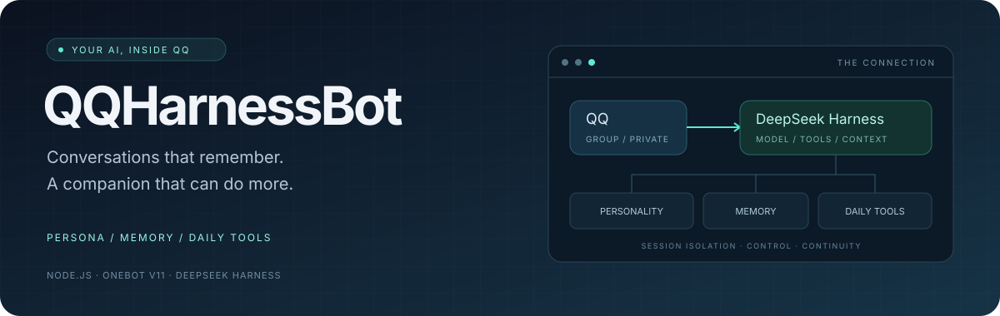
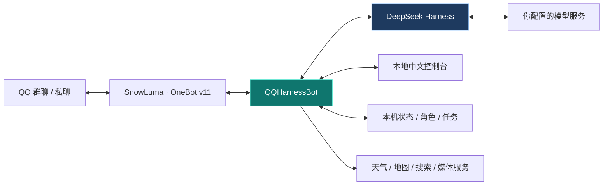

<div align="center">



# 🤖 QQHarnessBot

**你的 QQ AI 伙伴 · Powered by DeepSeek Harness**

让 QQ 里的 AI 拥有自己的角色、延续对话中的记忆，<br/>
也能帮你查天气、找地点、整理任务，参与日常生活。

<br/>

[](https://nodejs.org/)


[](https://github.com/YZzy2006/QQHarnessBot/actions/workflows/checks.yml)
[](LICENSE)
[](https://github.com/YZzy2006/QQHarnessBot/stargazers)

**角色与记忆 · 主动互动 · 生活工具 · 中文控制台**

[快速开始](#quick-start) · [功能总览](#features) · [使用文档](#documentation) · [提交反馈](https://github.com/YZzy2006/QQHarnessBot/issues)

</div>

---

> 基于 [Derpyu520/qq-bridge](https://github.com/Derpyu520/qq-bridge) 扩展，保留上游 MIT 许可证与署名。QQHarnessBot 连接你自行运行的 **SnowLuma / OneBot v11** 与 **DeepSeek Harness**；来源与第三方许可见 [NOTICE.md](NOTICE.md)。

## 📌 从这里开始

| 我想…… | 阅读入口 |
| --- | --- |
| 看看它有哪些能力 | [功能总览](#features) |
| 了解消息如何流转 | [系统架构](#architecture) |
| 在自己的电脑或服务器运行 | [快速开始](#quick-start) |
| 配置模型、天气、搜索和语音 | [可选服务](#services) |
| 找具体指令与使用方法 | [中文文档](#documentation) |
| 参与开发或了解数据边界 | [开发与验证](#development) · [隐私与权限](#privacy) |

<a id="features"></a>

## ✨ 不止于回复消息

| 🎭 角色与聊天 | 🧠 记忆与陪伴 | 🧰 日常工具 |
| --- | --- | --- |
| Markdown 人物卡，群聊与私聊分别维护会话 | 共同回忆、纪念日、时光胶囊与专注计时 | 天气、地图、待办、便签与文件对比 |
| 💬 主动互动 | 🛡️ 权限与控制 | 🖥️ 中文控制台 |
| 唤醒、潜水、静默、主动互动与忙时排队 | 会话白名单、发送额度、操作确认与回复审计 | 管理会话、角色、工具权限、唤醒策略与用量 |

### 一个伙伴，也是一组顺手的工具

| 场景 | 可以做什么 |
| --- | --- |
| **延续对话** | 群聊与私聊分别维护上下文；管理角色卡，并在正常唤醒时刷新角色版本 |
| **安排日常** | 管理任务和便签；记录纪念日、专注计时与时光胶囊 |
| **天气与出行** | 查询天气并继续追问；查找地点、切换地图来源，明确确认后发送位置卡片 |
| **整理信息** | 消息搜索、群摘要、群知识、截图待办、文件对比与报错档案 |
| **协助管理** | 公告草稿与确认发布、白名单管理、暂停、手动唤醒与发送限额 |
| **多种表达** | 按配置启用图片理解、语音识别、语音合成与图片生成 |
| **关注兴趣** | 公开联网搜索、兴趣主题与简报；可选功能需配置对应服务 |

**这些表达可以接着说：**

```text
[天气查询][广州][明天]
  ↳ 那后天呢？

[找店][广州][咖啡店]
  ↳ 换腾讯的 → 选第二个 → 发这个
```

天气、地点的连续追问按**本人 + 当前会话**隔离。普通查询只读，位置卡片需明确发送；实际来源、额度及失败原因以工具结果为准。

<details>
<summary><strong>🧪 下一批更新：资料工具与媒体体验（公开仓库尚未发布）</strong></summary>

<br/>

以下能力已在开发版本实现，相关源码尚未推送至当前公开版本；从本仓库默认分支安装时，请以实际代码为准。

| 能力 | 开发版本中的行为 |
| --- | --- |
| 截图转 Excel | 先识别和预览，确认后导出；保留前导零，按文本写入单元格 |
| 文件内容问答 | 回答附原文引用，程序核对引用内容与覆盖范围 |
| 日历与课程表 | ICS / 课程表预览导入，确认后写入独立日历 |
| 更新与异常监测 | RSS / 网页变化、连续异常与恢复通知 |
| 视频理解 | 原视频与平台公开分享的采样理解、音轨转写和时间点追问 |
| 连续改图 | 参考原图与当前版本编辑，支持上一版和回到原图 |
| 对话式工具 | 常用自然表达映射到受限工具，写操作仍需确认 |
| 图文结果 | 较长工具结果可渲染成 PNG 卡片，并取回文字原文 |

平台分享受登录、地区、风控和页面变动影响；无法取得实际视频时应提示上传原视频，不能只凭标题声称理解内容。这里的视频能力指消息附件与链接分析。

</details>

<a id="architecture"></a>

## 🏗️ 清晰的连接关系



| 层面 | 使用的技术 | 职责 |
| --- | --- | --- |
| QQ 接入 | **OneBot v11 · SnowLuma SDK** | 接收消息与事件，提交 QQ 动作 |
| 桥接运行时 | **Node.js 22.13+ · JavaScript ESM** | 会话路由、权限、队列、额度与审计 |
| 模型与工具运行时 | **DeepSeek Harness · MCP** | 模型对话、预设与受限工具调用 |
| 管理界面 | **本地 Web 控制台** | 中文管理界面与运行状态查看 |
| 数据与配置 | **本机 JSON / Markdown** | 配置、人物卡、会话和工具状态 |
| 可选外部能力 | **天气 / 地图 / 搜索 / 语音 / 图像 API** | 按启用的功能连接对应供应商 |

DSH 接入使用 Cookie 鉴权、斜杠 RPC 和事件流。当前适配来源为 **DSH 0.2.0-rc.2 代际**，具体上游变化仍可能需要适配。

<a id="quick-start"></a>

## 🚀 快速开始

### 1. 准备运行环境

- **Node.js ≥ 22.13** 与 Git。
- 自行安装、启动并登录 [DeepSeek Harness](https://github.com/deepseek-ai/deepseek-harness)，开启 Web 服务。
- 自行安装、启动并登录 SnowLuma，配置 OneBot v11 WebSocket 与 HTTP API。
- 准备你有权使用的 QQ 账号与模型服务。

桥接不捆绑 QQ 客户端、SnowLuma 本体、原生组件或任何登录态。

### 2. 克隆与安装

```bash
git clone https://github.com/YZzy2006/QQHarnessBot.git
cd QQHarnessBot
npm ci
```

安装时的 `postinstall` 只修补本机 `@snowluma/sdk` 安装副本的 ESM 相对导入扩展名，不安装、启动或修改 SnowLuma 本体。依赖的实际下载来源与版本以锁文件为准。

### 3. 创建自己的配置

**Windows / PowerShell**

```powershell
Copy-Item config.example.json config.json
Copy-Item .env.example .env
```

**Linux / macOS**

```bash
cp config.example.json config.json
cp .env.example .env
chmod 600 config.json .env
```

编辑 `config.json`：

| 配置项 | 需要填写的内容 |
| --- | --- |
| `ownerQQ` | 你自己的管理员 QQ 号 |
| `allow.private` / `allow.groups` | 允许接入的私聊和群号，建议先放一个测试会话 |
| `dsh.baseUrl` | DSH Web 地址，默认 `http://127.0.0.1:3080` |
| `dsh.provider` / `dsh.model` / `dsh.reasoningEffort` | 你的 DSH 实际支持的供应商、模型和推理档位 |
| `snowluma.wsUrl` / `snowluma.httpUrl` | OneBot 地址，默认本机 `3001` / `3000` 端口 |
| `snowluma.accessToken` | 你自己的 OneBot 访问令牌 |
| `consoleToken` | 本地控制台令牌，留空时由程序生成 |

`dsh.authToken` 通常留空，由桥接使用你自己的 DSH 本机凭据获取会话 Cookie。多实例部署建议关闭 `snowluma.followDiscoveredEndpoint`，明确指定网关地址。

示例配置采用保守默认值：空白名单不放行，不自动加入新好友，不默认启用黑话外部研究与普通主动问候。可在控制台逐项开启需要的功能。

### 4. 注册预设并启动

```bash
npm run setup:dsh
# 按提示重启 DSH 后，再启动桥接
npm start
```

`setup:dsh` 在你自己的 DSH `web` profile 注册 `qq-chat` / `qq-chat-v2` 预设和 MCP 工具，并为相关文件留时间戳备份。执行前请确认目标 profile。

<details>
<summary>使用其他 DSH 目录或 profile</summary>

<br/>

可用 `DSH_HOME` 指定 DSH 目录。其他 profile 使用：

```bash
node --env-file-if-exists=.env scripts/setup-dsh.mjs <profile>
```

</details>

<a id="services"></a>

## 🔌 按需连接你的服务

聊天模型由 DSH 管理；天气、地图、搜索、语音和图像是可选扩展。没有配置某项服务时，该功能不可用或按已有规则兜底。

| 能力 | 环境变量 / 本机配置 |
| --- | --- |
| 和风天气 | `HEFENG_WEATHER_API_KEY` + 账号对应的 `HEFENG_WEATHER_API_HOST` |
| 高德地图 | `GAODE_WEB_API_KEY` |
| 腾讯地图 | `TENGXUNDITU_API_KEY` |
| 天地图 / 百度地图 | `TIANDITU_API_KEY` / `BAIDUDITU_API_KEY` |
| 博查搜索 | `BOCHA_API_KEY`，或本机 `state/.bocha-key` |
| DeepSeek 检索 | `DEEPSEEK_API_KEY`，或本机 `state/.deepseek-key` |
| 元宝搜索兜底 | `YUANBAO_SEARCH_API_KEY`，或本机 `state/.yuanbao-search-key` |
| 图片理解、语音与通义图片 | `QWEN_API_KEY` / `BAILIAN_API_KEY` / `DASHSCOPE_API_KEY`，按功能支持范围配置 |
| 豆包图片 | `DOUBAO_API_KEY` |

密钥自行申请，只填在本机配置中。[.env.example](.env.example) 不包含真实密钥。`npm start` 读取本机 `.env`，但 DSH 启动的 MCP 子进程不一定继承桥接环境；检索服务可使用表中的受保护密钥文件。

<a id="documentation"></a>

## 📚 中文使用文档

| 文档 | 适合什么时候看 |
| --- | --- |
| [管理员便捷指令](docs/OWNER-TOOLS-USAGE.md) | 任务、便签、查询、管理与操作确认 |
| [天气、地点与陪伴](docs/COMPANION-USAGE.md) | 天气追问、地点卡片、纪念日与专注 |
| [个人设置与扩展工具](docs/UTILITIES-USAGE.md) | 群知识、文件对比、截图待办与兴趣简报 |
| [连续追问与请求队列](docs/REQUEST-CONTINUITY.md) | 连续选择、忙时排队和地图发送边界 |
| [隐私、安全与数据流](SECURITY.md) | 输入会发送给谁、哪些数据留在本机 |
| [参与贡献与安全发布](CONTRIBUTING.md) | 本地开发、发布清单与检查流程 |
| [来源与第三方许可](NOTICE.md) | 上游署名、组件来源与使用条件 |

<a id="development"></a>

## 🛠️ 开发与验证

```bash
npm test
npm run check:release
npm run hooks:install
```

- **离线回归**：测试使用临时目录和假 QQ / DSH / 供应商响应，无需生产密钥。
- **发布门禁**：显式文件清单、敏感文件名与密钥特征检查，并检查暂存区和 Git 历史；CI 另运行 Gitleaks。
- **真实验收**：自动测试不代替模型质量、供应商账号权限或 QQ 客户端显示与下载验收。

```text
QQHarnessBot/
├── src/                  桥接运行时、会话与功能模块
├── public/               中文控制台
├── dsh/                  DSH 聊天预设
├── plugins/              预设与权限相关插件
├── scripts/              安装辅助、测试与发布检查
├── docs/                 中文使用说明
├── roles/                人物卡说明与示例
├── config.example.json   配置模板
└── .env.example          环境变量模板
```

<a id="privacy"></a>

## 🔐 把权限和数据边界说清楚

| 边界 | 行为 |
| --- | --- |
| **接入范围** | 白名单控制私聊和群聊；不同会话分别维护上下文 |
| **管理操作** | 管理员与普通成员分权，涉及写入或投递的工具有相应确认与审计 |
| **私人周记** | 独立生成和投递，受管正文路径阻止进入聊天、引用和长期记忆 |
| **本机数据** | 真实配置、私人角色、会话记录、备份和登录态不随公开仓库提供 |
| **外部服务** | QQ 消息可能经 DSH 发往所选模型；查询、语音和图像会发往对应供应商 |

请告知参与者相关数据流。私人内容被自行改写、重新拍照或经第三方转述时，无法保证程序自动识别。平台访问限制、额度和费用由相应服务决定；扫描也不能代替人工审查。

## ❓ 开始前常见的几个问题

<details>
<summary><strong>需要在服务器上部署大模型吗？</strong></summary>

<br/>

不要求。桥接通过 DSH 使用你配置的模型服务；模型运行在哪里取决于你的 DSH 配置。语音、图像等扩展分别使用对应服务。

</details>

<details>
<summary><strong>支持所有 DSH 版本和 QQ 客户端吗？</strong></summary>

<br/>

不能保证。DSH 上游接口与 QQ 网关行为可能变化，应按本仓库适配说明核对。接口提交成功也不代表每个 QQ 客户端都能正确显示或点击位置卡片。

</details>

<details>
<summary><strong>为什么天气、地图或语音没有响应？</strong></summary>

<br/>

先核对对应服务是否配置、功能权限是否启用、当前会话是否在白名单内，再查看额度与错误说明。可选服务不可用不意味着需要更换聊天模型。

</details>

<details>
<summary><strong>开源仓库里有维护者的聊天记录和配置吗？</strong></summary>

<br/>

公开版使用独立发布目录与独立 Git 历史，不携带维护者原运行仓库的真实配置、私人角色卡、聊天记录、管理员周记、备份和登录二维码。请在本机创建自己的配置。

</details>

## 🙏 致谢与许可证

感谢 [qq-bridge](https://github.com/Derpyu520/qq-bridge)、[DeepSeek Harness](https://github.com/deepseek-ai/deepseek-harness) 及其贡献者。

桥接代码沿用 [MIT](LICENSE)，保留原始版权声明；新增贡献归相应贡献者所有。SnowLuma 本体、原生组件与其他依赖按各自许可使用，项目的 MIT 许可证不对这些组件重新授权，详见 [NOTICE.md](NOTICE.md)。

---

<div align="center">

**把一次对话，慢慢变成日常。**

如果这个项目对你有帮助，欢迎 **Star ⭐**，也欢迎带着问题和想法参与改进。

[项目主页](https://github.com/YZzy2006/QQHarnessBot) · [问题反馈](https://github.com/YZzy2006/QQHarnessBot/issues) · [参与贡献](CONTRIBUTING.md)

</div>
